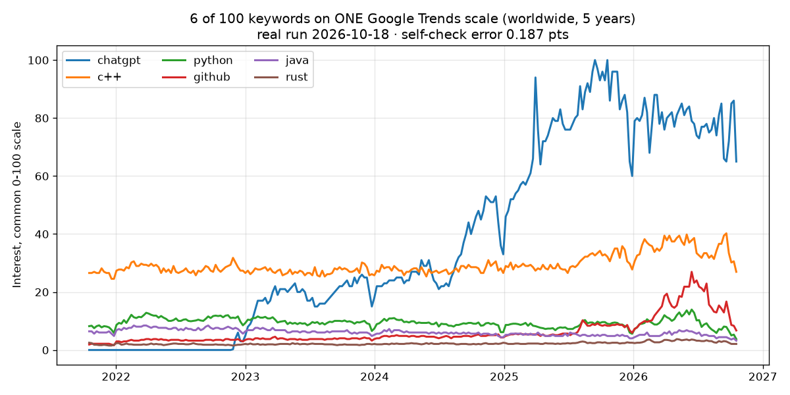

# Compare 100 Google Trends keywords on one scale



## The problem
Google Trends compares at most **5 terms** per request and rescales every request so that *its own* highest point is 100.
If you paste several 5-keyword exports together, "50" means something different in each batch, so the numbers can't be compared.
In a simulation that reproduces Google's rescaling and integer rounding with known ground truth, naive concatenation was off by **more than 20 index points**.

## The method
1. Query the first 5 keywords and pick a **mid-popularity anchor**.
2. Query the remaining keywords as *anchor + 4 others*.
3. Keywords much bigger or smaller than the anchor lose precision (values rounded to integers, tiny values become 0 or "<1"), so they are **re-measured in overlapping batches** with keywords of similar size.
4. Solve **one scale factor per batch with weighted least squares** over all shared keywords (weights = rounding precision).
5. Rescale so the global maximum is 100.
6. **Self-check**: 5 keywords measured in different batches are queried directly together and compared with the chained values.

## Real accuracy numbers (runs on 2026-10-18/19)
| Run | Keywords | Self-check mean abs. error (0-100 scale) |
|---|---|---|
| Worldwide, 5 years (chart above) | 100 | 0.187 points (max 1.01) |
| US-CA, 2024, YouTube | 25 | 0.149 points |
| US, 12 months, Apify cloud, residential proxy | 25 | 0.592 points |

Synthetic data with known truth (100 keywords spanning 3-4 orders of magnitude): every well-measured keyword within ~0.3 points mean absolute error.

## Run it
The method is packaged as an Apify Actor: **[Google Trends Scraper – Compare 100 Keywords](https://apify.com/satin_armeria/google-trends-advanced-comparator)**.

```bash
pip install apify-client matplotlib
export APIFY_TOKEN=<your token>   # from a free Apify account: Console > Settings > API & Integrations
python compare.py
```

`compare.py` compares 12 AI-tool keywords worldwide over 12 months, prints the self-check error and saves `comparison.png`.

## Cost
Pay per result: **$2 per 1,000 keywords compared** ($0.002 each) plus Apify's $0.00005 start fee.
Only keywords actually delivered are charged; failed or no-data keywords are free. This example (12 keywords) costs about **$0.025**.

## Limitations
- Google Trends data is sampled and can vary slightly between requests.
- Very small keywords next to very large ones may come back as "no data".
- Not an official Google API; not affiliated with Google.

## License
MIT
